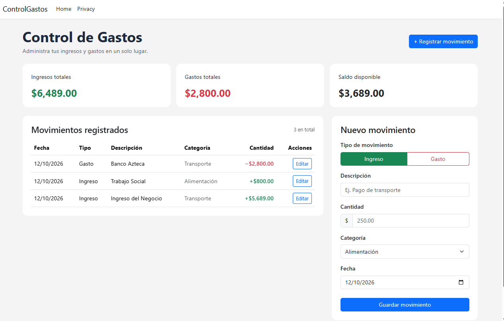

Control de Gastos
Aplicación web para registrar ingresos y gastos, consultar movimientos y calcular el saldo disponible.
(C# ,ASP.NET Core MVC ,SQL Server)
---------------------------------------------------------
Funciones
-Registrar ingresos y gastos.
-Clasificar movimientos por categoría.
-Consultar los movimientos registrados.
-Calcular automáticamente los ingresos, gastos y saldo.
##Captura de Ejecucion del Programa
##Panel 

Tecnologías utilizadas
C# y ASP.NET Core MVC
SQL Server
Entity Framework Core
HTML, CSS y Bootstrap
